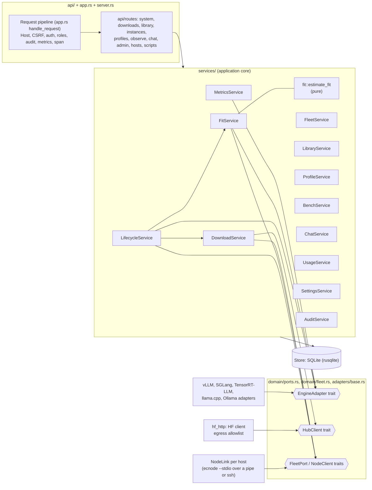

# C4 level 3: hub components

Rust crate `backend/crates/ec-hub` (source under `src/`). Since contract v2 the hub reaches docker, GPUs and model
files only through a node (see `c4-fleet.md`), so it has no command-runner or GPU-probe port of its own.

Wiring lives in `container.rs` (`build_container`), which accepts fakes for the ports so the tests run offline.

Not rendered: this diagram was written by hand and has not been run through a Mermaid renderer.
