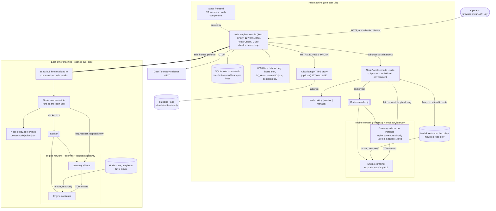

# C4 level 2: containers (deployable units)

This is the contract v2 picture (docs/ARCHITECTURE.md section 10): the hub never runs docker, reads `/proc` or opens a
model directory itself. Every machine, the hub's own included, is reached through a node (`ecnode --stdio`). The next
page, `c4-fleet.md`, shows the same system from the fleet's point of view (links, policies, trust boundaries).

Reading the picture:

- The only link from the hub to another machine is the ssh session that starts that machine's node. Nothing new
  listens on the network on either side. The hub's own machine uses a plain subprocess instead of ssh.
- Downloads and copies are not drawn: bytes go from Hugging Face (or from one node's `fs.read`) through the hub into a
  node's `fs.write`; the hub keeps no model files (ADR-0018).
- Engines discovered by a node (containers it did not create, bare loopback ports) are listed from the node's
  inventory. They are never attached to the engine network or given a gateway by the console (ADR-0013, ADR-0019).
- Access from another container (for example an OpenAI-compatible router) to an engine is still opt-in and is a
  per-machine docker matter: the operator joins that container to that machine's engine network. See OPERATIONS.md.

Not rendered: this diagram was written by hand and has not been run through a Mermaid renderer.
