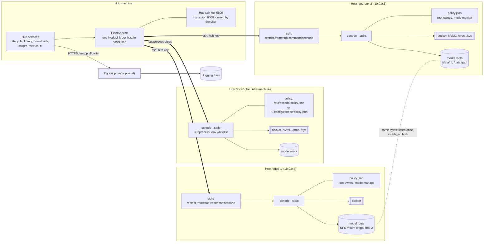
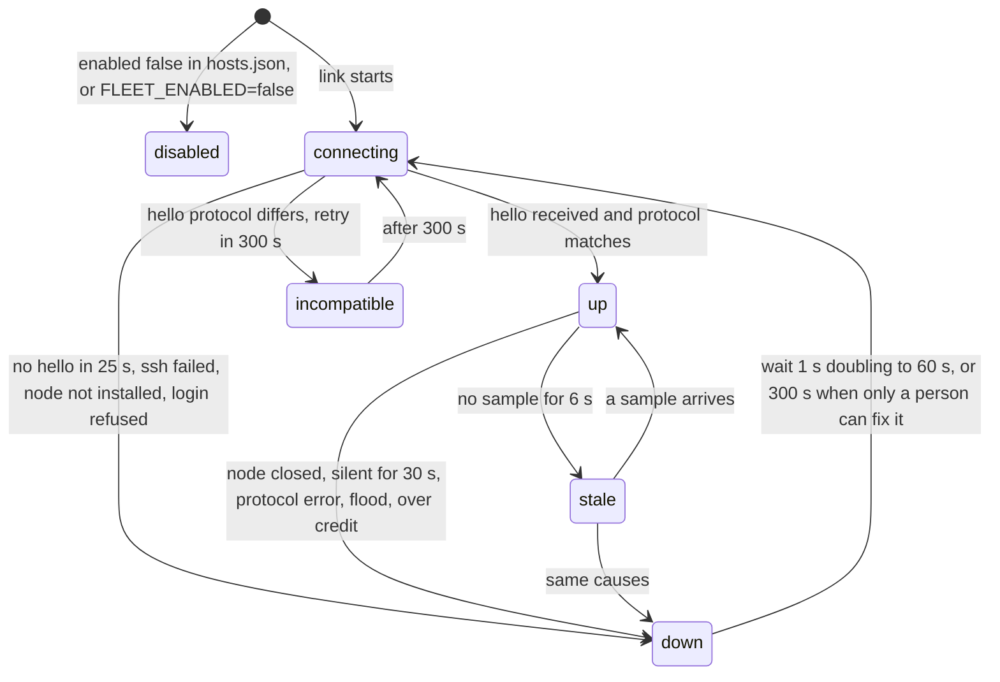

# C4 fleet view: hub, links, nodes, policies and trust boundaries

Contract v2 (docs/ARCHITECTURE.md section 10, docs/FLEET-PROTOCOL.md). Names such as `gpu-box-2`, `edge-1` and the
addresses are examples. The second diagram is the state machine of one link (`LinkState` in `domain/fleet.py`).

## Structure and trust boundaries

Trust boundaries, from the outside in:

1. Browser or curl to the hub: Host allowlist, Origin and CSRF checks, bearer key (loopback is not trusted).
2. Hub to node: a pipe (local) or an ssh session whose key sshd restricts to the node command. The hub treats every
   node as untrusted data (`proto.sanitize_*`, flood and credit limits). The node treats the hub as its operator but
   obeys its own policy first and never lets the hub edit it.
3. Node to docker and the filesystem: argv lists only, owned containers only (label `engine-console=1`), file
   operations confined to the policy's model roots.
4. Engine to anything else: internal network, no published ports, no route out.

## One link

`up` and `stale` are the only states in which numbers from the node are shown as live. A request to a node whose link is
`connecting`, `down`, `incompatible` or `disabled` fails at once with `node_unavailable` (HTTP 503). The Reconnect
action skips the wait and restarts the attempt.

Not rendered: these diagrams were written by hand and have not been run through a Mermaid renderer.
