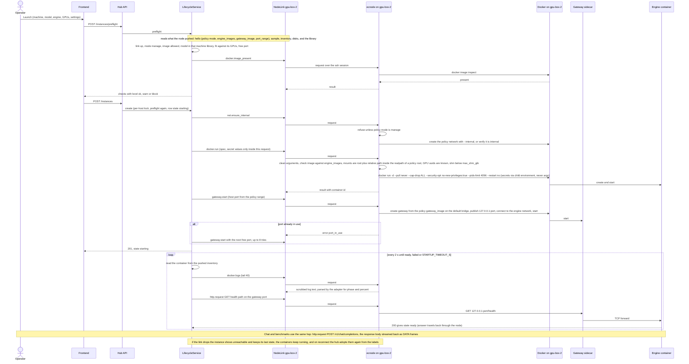

# Sequence: starting an engine on another machine

Contract v2 (docs/ARCHITECTURE.md sections 10.4 and 10.11, docs/FLEET-PROTOCOL.md sections 4 and 5; code:
`services/lifecycle.py`, `services/fleet.py`, `node/src/ecnode/ops.py`). The machine here is `gpu-box-2`. The link to it
is already up: the hub started `ssh ... -- user@10.0.0.5 /usr/local/lib/ecnode/ecnode --stdio` earlier, sshd ran the
forced command from the restricted key, and the node sent its `hello` (including its policy summary).

For the hub's own machine the sequence is the same with the ssh hop replaced by the subprocess pipes. Status of this
sequence: the local variant was exercised live by the maintainers (one vLLM instance on one GPU, real rootless Docker); the ssh
variant has only been exercised against fakes and a real `ssh -G` check of the
command line.

What the node refuses, and the code the hub shows (full list in OPERATIONS.md, troubleshooting):

- policy mode is `monitor`: `monitor_only` (HTTP 409).
- image not matched by the policy's `engine_images`: `policy_denied` (403); the hub's own preflight says
  `image_not_allowed` first.
- the policy names no `gateway_image`: preflight check `gateway_missing`; `gateway.start` would answer `policy_denied`.
- a mount outside every policy root, or a path that leaves its root: `policy_denied` / `bad_args`.
- a node that cannot be reached: `node_unavailable` (503), and preflight check `host_down`.

Not rendered: this diagram was written by hand and has not been run through a Mermaid renderer.
