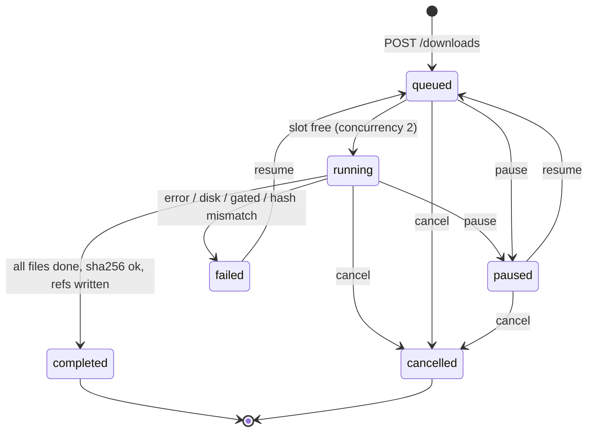

# State machine: download

States are the `state` values of a download (`Download` in `backend/crates/ec-hub/src/domain/models.rs`); transitions are in `backend/crates/ec-hub/src/services/downloads.rs`.

On console restart `recover()` parks rows left `running` or `queued` as `paused` so they can be resumed.
